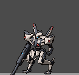

# momecha

A top-down pixel-art mech game set in a ruined night city. Long-term goal: a web-first online game with thousands of players. First milestone: a single-player game that teaches the basics.



## What's here

| Path | What it is |
|---|---|
| `prototype/` | The playable mockup: one HTML file, plain JavaScript + canvas, no build step. Heron flies around the Dry Canal District. |
| `art/mechkit/` | Python mech kit: a small SDF raymarch renderer (`r3d.py`), the part library (`kit*.py`) and mech specs (`specs/*.json`). Builds 3D mechs from parts and renders them to quantized pixel sprites (`mech3.py`). |
| `art/sprites/heron_sheet.py` | Poses Heron 16 ways x 8 directions and renders the game sprite sheet. |
| `art/renders/` | Reference renders of the four study mechs (Heron, Vane, Bastion, Lance). |

## Run the prototype

It loads `heron.png` with a relative path, so serve the folder rather than opening the file directly:

```
cd prototype
python3 -m http.server 8000
# open http://localhost:8000
```

Controls: WASD / arrows to boost, Shift to quick boost, Space to take off or land, click to fly there. Left alone, it patrols on autopilot.

## Re-render the Heron sprite sheet

Needs Python 3 with `pip install numpy pillow`. Takes about 4 minutes on 4 cores.

```
python3 art/sprites/heron_sheet.py prototype/heron.png 88 .86 38
```

Arguments: frame size (px), model scale (.86 ≈ 46 px tall), camera pitch (degrees). Add a direction (0-7) as a 5th argument to render one row only while iterating.

## Next step

Port `prototype/` to TypeScript + Phaser 3 + Vite (see `CLAUDE.md`).
